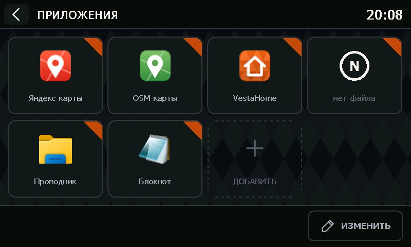

# VestaLaunch

Лаунчер программ для штатной ММС Lada Vesta (Windows CE 6.0, экран 800×480). Встаёт на кнопку
«Навигация» штатной оболочки: нажали «Навигация» — открылся список ваших программ
(навигаторы, карты, плееры), нажали плитку — программа запустилась поверх оболочки. Оформлен в стиле
оболочки VestaHome: тёмная тема, один оранжевый акцент.



## Возможности
- Плитки программ по 8 на страницу; страницы листаются свайпом или точками внизу.
- Ярлыки добавляются, меняются и удаляются прямо на ГУ: кнопка «Изменить», своя экранная клавиатура (русская и английская раскладки) и свой выбор файлов.
- Значок программы берётся из её exe; можно назначить свой — `.png` (до 256×256), `.ico` или другой
  exe/dll. Если программы по указанному пути нет, плитка подписана «нет файла».
- Повторное нажатие на уже запущенную программу не запускает вторую копию, а выводит её окно вперёд.
- Программа, запущенная из лаунчера, держится поверх оболочки, вместе со своими диалогами. Когда её
  закрывают, лаунчер возвращается сам.
- Если программа зависла или упала и её окно пропало, а процесс остался (на экране только чёрная
  страница навигации), через 10 с лаунчер уходит в штатную оболочку.
- «Назад» (стрелка вверху слева) — обратно в окно, поверх которого лаунчер открыли: штатную оболочку
  или VestaHome. Оболочка получает сигнал «навигация закрыта» и возвращается на свои экраны.
- Цвета и картинки интерфейса задаются в `Skin\skin.ini` — без пересборки программы.

## Установка
Нужен установщик `LaunchInstall.exe` из [Releases](../../releases) (внутри — сам VestaLaunch со скином).

1. Положить `LaunchInstall.exe` на SD-карту и запустить его на ГУ (например, через проводник).
2. Нажать «Установить». Установщик спросит разрешения закрыть оболочку — для патча её нужно закрыть, после
   установки он сам запускает её снова.
3. На ГУ кнопка «Навигация» поменялась на "Программы". Нажимаем — откроется VestaLaunch.

Что делает установщик: кладёт VestaLaunch в `\SDMMC\VestaLaunch`, ставит его первой строкой в
`Config\ExternNavi.cfg` оболочки и меняет в `G3NavHMI.exe`
(`127.0.0.1` → `127.0.0.2`). Перед изменениями сохраняет копии, каждый шаг пишет в журнал и при любой
ошибке откатывает всё сделанное. «Удалить» возвращает оболочку как было. Подробности — в
[LaunchInstall/README.md](LaunchInstall/README.md).

VestaLaunch ставится на встроенную карту `\SDMMC`, а не на съёмную SD, без съёмной карты оболочка не потеряет лаунчер.

## Список программ (`apps.txt`)
Лежит рядом с `VestaLaunch.exe`, кодировка UTF-8. Обычно его меняют кнопкой «Изменить», но можно и
вручную. Одна строка — одна плитка, поля через `|`:

```
Имя | путь к exe | класс!заголовок окна | параметры | свой значок
Яндекс карты | \SDMMC\YaMapsCE\YaMapsCE.exe
OSM карты | \SDMMC\OSMapsCE\OSMapsCE.exe
Навигатор | \SDMMC\Navi\Start.exe | NaviWndClass! | | Icons\navi.png
```

- Обязательны только имя и путь.
- **Класс и заголовок окна** — для программ, которые запускаются через посредника (MortScript и т. п.):
  лаунчер будет ждать и поднимать именно это окно. Формат `класс!заголовок`, любую часть можно опустить.
- **Параметры** — командная строка программы.
- **Свой значок** — путь к `.png`, `.ico` или exe/dll. Относительный путь — от папки лаунчера; свои
  картинки удобно класть в `\SDMMC\VestaLaunch\Icons`.
- При первом запуске лаунчер сам создаёт пример списка с комментариями.

## Оформление (`Skin\skin.ini`)
`[colors]` — цвета в виде `RRGGBB` (фон, плитки, линии, текст, акцент…); `[images]` — PNG-картинки
кнопок из папки `Skin` (с прозрачностью), `<имя>_down` — отдельная картинка нажатой кнопки,
`background` — фон 800×480 вместо узора. Чего нет в файле — рисуется встроенным кодом. Каждая
картинка занимает память ГУ (значок 64×64 — 16 КБ, фон — 750 КБ).

## Если что-то не так
- `VestaLaunch.log` рядом с exe: что запускалось, что было на экране, когда лаунчер уходил и возвращался.
- `LaunchInstall.log` рядом с установщиком и `\SDMMC\VestaLaunch_install.jrn` — шаги установки.
- Вернуть всё как было — «Удалить» в установщике.

## Сборка
Visual Studio 2005 с поддержкой Smart Device и SDK Pocket PC 2003:

1. `native\build.bat` → `VestaLaunch\VestaLaunch.exe` (ARM) и `VestaLaunchPC.exe` (ПК, для проверки
   интерфейса).
2. `LaunchInstall\native\build.bat` → `LaunchInstall\LaunchInstall\LaunchInstall.exe`: в установщик
   упаковывается текущая сборка из `VestaLaunch\` (exe + `Skin`), поэтому собирать его — после шага 1.

`VestaLaunchPC.exe /export` выгружает встроенную графику в `Skin\` (PNG и `skin.ini` по умолчанию).
