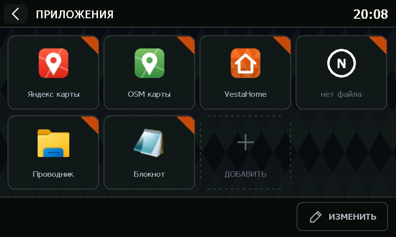

# VestaLaunch

Запуск программ для головного устройства (ГУ) MMC Lada Vesta на Windows CE 6 с экраном 800×480. Встаёт на кнопку
«Навигация» штатной оболочки: нажали кнопку — открылся список ваших программ (навигаторы, карты, плееры), нажали
плитку — программа запустилась поверх оболочки. Радио, музыка, телефон и настройки оболочки остаются прежними.
Программа бесплатная.

## Возможности

- **Кнопка «Программы»** вместо «Навигации» открывает VestaLaunch.
- **Свой список программ:** плитки по 8 на страницу, ярлыки правятся прямо на ГУ (своя клавиатура и выбор файлов).
- **Программа поверх оболочки;** после её закрытия на экран возвращается VestaLaunch.
- **Одна копия программы:** повторное нажатие на плитку выводит её окно вперёд.
- **Камера заднего хода** оболочки выходит поверх навигатора.
- **Диспетчер задач:** загрузка процессора и памяти, процессы и окна.
- **Своё оформление** в `Skin\skin.ini`.

## Установка

1. Скачайте архив `VestaLaunchInstall` из [Releases](../../releases) и распакуйте на SD-карту.
2. Запустите `LaunchInstall.exe` на ГУ (из проводника или кнопкой «Навигация»).
3. Нажмите **УСТАНОВИТЬ** и перезагрузите ГУ.

Установщик рассчитан на штатную оболочку прошивки 4120; незнакомую или защищённую прошивку он не меняет. Подробно — в
[руководстве пользователя](docs/manual.md#2-установка-обновление-удаление).

## Документация

- [Руководство пользователя](docs/manual.md)

## Сборка

Visual Studio 2005 с поддержкой Smart Device и SDK Pocket PC 2003:

1. `native\build.bat` → `VestaLaunch\VestaLaunch.exe` (ARM) и `VestaLaunchPC.exe` (ПК, для проверки интерфейса).
2. `LaunchInstall\native\build.bat` → `LaunchInstall\LaunchInstall\LaunchInstall.exe`. В установщик упаковывается
   текущая сборка из `VestaLaunch\` (exe и `Skin`), поэтому его собирают после шага 1.

`VestaLaunchPC.exe /export` выгружает встроенную графику в `Skin\`: PNG и `skin.ini` по умолчанию.

Общие модули — подмодуль `core` ([VestaCore](https://github.com/TpuPyku/VestaCore)).

## Лицензия

© 2026 TpuPyku. GNU GPL версии 3 (`LICENSE`): программу можно свободно использовать, изменять и распространять, в том
числе за деньги и в составе прошивок, но только вместе с исходным кодом всей программы и всех изменений, под той же
лицензией. Сторонние части — `THIRD_PARTY.txt`.

## Другие программы

- [VestaHome](https://github.com/TpuPyku/VestaHome) — своя оболочка ГУ вместо штатной.
- [OSMapsCE](https://github.com/TpuPyku/OSMapsCE) — карта OpenStreetMap с пробками и офлайн-маршрутами.
- [YaMapsCE](https://github.com/TpuPyku/YaMaps) — карта Яндекса с пробками.

## Поддержать проект

VestaLaunch бесплатен. Если программа вам понравилась:

- поставьте ⭐ звезду репозиторию (кнопка **Star** вверху страницы) — так VestaLaunch проще найти другим владельцам Весты;
- поддержите разработку на [Boosty](https://boosty.to/vesta_home) — добровольно, всё остаётся бесплатным.
