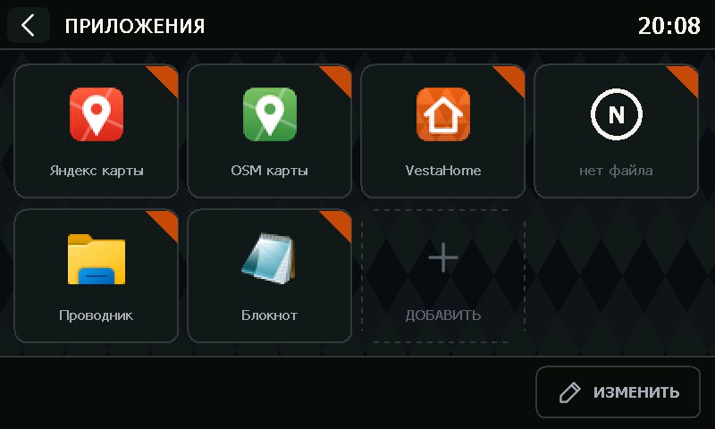

# VestaLaunch — руководство пользователя

VestaLaunch — запуск программ для головного устройства (ГУ) MMC Lada Vesta на Windows CE 6 с экраном 800×480. Он
встаёт на кнопку «Навигация» штатной оболочки. Нажали кнопку — открылся список ваших программ: навигаторы, карты,
плееры. Нажали плитку — программа запустилась поверх оболочки. Программа бесплатная.



Версия программы написана мелко внизу экрана «Приложения», под точками страниц. Номер вида `1.05.ГГММДД`: в конце
стоит дата сборки.

**Содержание**

1. [Что такое VestaLaunch](#1-что-такое-vestalaunch)
2. [Установка, обновление, удаление](#2-установка-обновление-удаление)
3. [Экран приложений](#3-экран-приложений)
4. [Запуск программ](#4-запуск-программ)
5. [Изменение ярлыков](#5-изменение-ярлыков)
6. [Диспетчер задач](#6-диспетчер-задач)
7. [Оформление](#7-оформление)
8. [Безопасность и возврат к штатной оболочке](#8-безопасность-и-возврат-к-штатной-оболочке)
9. [Журналы и помощь](#9-журналы-и-помощь)
10. [Другие наши программы](#10-другие-наши-программы)

---

## 1. Что такое VestaLaunch

VestaLaunch дополняет штатную оболочку ГУ. Оболочка остаётся прежней: радио, музыка, телефон и настройки работают как
раньше. Меняется только кнопка «Навигация».

- **Кнопка «Программы».** Установщик переименовывает кнопку «Навигация» в «Программы» и ставит на неё значок с сеткой
  приложений. Кнопка открывает VestaLaunch.
- **Свой список программ.** Плитки по 8 на страницу. Ярлыки добавляются, меняются и удаляются прямо на ГУ: у
  VestaLaunch своя экранная клавиатура и свой выбор файлов. → [раздел 5](#5-изменение-ярлыков)
- **Программа поверх оболочки.** Запущенная программа остаётся на экране вместе со своими окнами и диалогами. Когда
  её закрывают, на экран возвращается VestaLaunch. → [раздел 4](#4-запуск-программ)
- **Одна копия программы.** Повторное нажатие на плитку запущенной программы выводит её окно вперёд.
- **Диспетчер задач.** Загрузка процессора и памяти, список процессов и окон. → [раздел 6](#6-диспетчер-задач)
- **Своё оформление.** Цвета и картинки задаются в файле `Skin\skin.ini`. → [раздел 7](#7-оформление)

VestaLaunch ставится на встроенную карту `\SDMMC`. Поэтому оболочка находит его и без съёмной SD-карты.

---

## 2. Установка, обновление, удаление

Всё делает один файл — `LaunchInstall.exe`. Он лежит в архиве `VestaLaunchInstall-<версия>.zip` на странице
[Releases](https://github.com/TpuPyku/VestaLaunch/releases).

Установщик рассчитан на штатную оболочку прошивки 4120. Он работает с файлами оболочки в папке
`\ResidentFlash\navigation\app`. Незнакомую прошивку он распознаёт и ничего в ней не меняет
([отказы](#отказы)).

Запустить установщик можно двумя способами: из проводника Windows или кнопкой «Навигация» штатной оболочки.

### Как выйти на рабочий стол

Рабочий стол Windows CE с проводником нужен, чтобы запустить установщик с карты. Способ взят с 4PDA (тема ММС Lada
Vesta, FAQ «Выход на Рабочий стол»).

1. На главном экране штатной оболочки нажмите «i».
2. В открывшемся окне коснитесь его углов по очереди: левый верхний, правый верхний, правый нижний, левый нижний.
   Откроется служебное меню.
3. Нажмите в нём «SYSTEM STATUS».
4. Снова коснитесь углов в том же порядке, теперь углов экрана. Отступите от краёв около 1 см.
5. Появится рабочий стол с проводником. Найдите в нём `LaunchInstall.exe` на карте и запустите.

### Запуск установщика кнопкой «Навигация»

Когда навигатор не запущен, штатная оболочка по кнопке «Навигация» сначала запускает файл `UPDATE\Updater.exe` с
SD-карты, если он там есть.

1. На компьютере создайте в корне SD-карты папку `UPDATE`.
2. Положите в неё `LaunchInstall.exe` и переименуйте его в `Updater.exe`.
3. Вставьте карту в ГУ и нажмите «Навигация». Откроется установщик.
4. После установки удалите `UPDATE\Updater.exe` с карты. Пока файл лежит там, оболочка запускает его при каждом
   нажатии кнопки, прежде чем открыть VestaLaunch.

Журнал установщика `LaunchInstall.log` в этом случае появится в той же папке `UPDATE`.

### Экран установщика

Вверху установщик пишет, что он нашёл:

- **Оболочка** — путь к `G3NavHMI.exe` и его состояние: «не найден», «не пропатчен», «пропатчен (127.0.0.2)» или
  «НЕЗНАКОМАЯ ПРОШИВКА»;
- **ExternNavi.cfg** — «VestaLaunch загружается первым» или «без VestaLaunch»;
- **VestaLaunch** — «установлен» или «не установлен»;
- **Кнопка «Навигация»** — какая на ней надпись («Навигация», «Программы», «нет», «не распознана») и какой значок
  («заводской», «наш», «другой», «нет»).

Ниже серая панель. Сначала в ней краткое описание, после нажатия кнопки — отчёт по шагам. Внизу четыре кнопки:
«УСТАНОВИТЬ», «УДАЛИТЬ», «ДИАГНОСТИКА», «ВЫХОД».

### Установка

1. Нажмите «УСТАНОВИТЬ».
2. Если оболочка ещё не изменена, установщик спросит: «Закрыть оболочку и продолжить?». Оболочку надо закрыть, чтобы
   поменять её файл. Без оболочки ГУ вскоре перезагружается сама, поэтому установщик сразу запускает её снова.
   Подтвердите.
3. Установщик проходит шаги и пишет каждый в панель:
   1. распаковывает VestaLaunch;
   2. меняет `G3NavHMI.exe`. Перед правкой делаются две копии:
      `G3NavHMI.exe.vlaunch.bak` рядом с оболочкой и `\SDMMC\VestaLaunch_backup\G3NavHMI.exe`;
   3. ставит строку `\SDMMC\VestaLaunch\VestaLaunch.exe` первой в `Config\ExternNavi.cfg`;
   4. меняет надпись кнопки «Навигация» на «Программы». Перед правкой делается копия `language_cn.qm.vlaunch.bak`;
   5. меняет значок кнопки `main_symbol_navigation.png` на свой. Только
      если файл заводской: значок другого скина остаётся;
   6. создаёт новую папку `\SDMMC\VestaLaunch`;
   7. если оболочку закрывали, запускает её и 30 секунд следит, что она работает.
4. В конце появится «ГОТОВО. Кнопка «Программы» открывает VestaLaunch.». Нажмите «ВЫХОД».

Если оболочка уже изменена (`127.0.0.2`), установщик её не закрывает и ни о чём не спрашивает. Шаги 2 и 7 тогда
пропускаются.

Любая ошибка записи или проверки отменяет установку. Оболочка, которая упала за 30 секунд наблюдения, тоже отменяет
её. Установщик возвращает все сделанные шаги в обратном порядке и запускает заводскую оболочку. В панели будет
«Установка не выполнена, система в прежнем состоянии.»

Каждый шаг записывается в журнал `\SDMMC\VestaLaunch_install.jrn` до того, как выполняется. Если ГУ выключилось
посреди установки, журнал остаётся. Тогда на экране установщика будет «Прерванная установка — будет возвращена.», и
следующее «УСТАНОВИТЬ» или «УДАЛИТЬ» сначала вернёт всё по журналу.

### Отказы

Перед любыми изменениями установщик проверяет прошивку. Если что-то не так, он ничего не меняет и пишет в панели
«Отказ:» и причину. Причины:

- «встроенные файлы установщика повреждены (CRC)» — файл установщика испорчен, скачайте его заново;
- «заряжено загрузочное обновление (\ResidentFlash\SwUpdate.flag)» — ГУ ждёт заводского обновления при загрузке;
- «нет G3NavHMI.exe»;
- «G3NavHMI.exe не читается как программа (нет заголовка MZ/PE) — раздел зашифрован или защищён»;
- «в G3NavHMI.exe не найден ровно один адрес 127.0.0.1 — незнакомая прошивка»;
- «ExternNavi.cfg не читается как текст — раздел зашифрован или файл чужой»;
- «в папку оболочки нельзя записать файл — раздел защищён»;
- «записанный в папку оболочки файл читается иначе — раздел шифрует файлы»;
- «пробный файл в папке оболочки не удаляется — раздел защищён»;
- «мало места для копии G3NavHMI.exe» — в папке оболочки нужно свободное место размером с `G3NavHMI.exe` и ещё
  512 КБ.

Для последних трёх проверок установщик записывает в папку оболочки пробный файл, читает его и удаляет.

Подробности отказа — в файле `LaunchInstall.log` в папке `SDMemory/VestaLogs`: размеры и первые байты `G3NavHMI.exe` и
`ExternNavi.cfg`, сколько раз встречаются адреса, состояние надписи и значка кнопки, итог пробной записи. Пришлите этот
файл вместе с журналом [диагностики](#кнопка-диагностика).

### Обновление

Запустите новый `LaunchInstall.exe` и нажмите «УСТАНОВИТЬ». Работающий VestaLaunch установщик закроет сам.

В новую версию переносятся:

- список программ `apps.txt`;
- папка `Icons` со своими значками;
- свои файлы в `Skin`: добавленные картинки и изменённые файлы оформления. Файлы, которые вы не меняли, заменяются
  новыми.

Чтобы отличать изменённые файлы, установщик записывает список своих файлов `shipped.crc`. У версий до 1.05.261117
этого списка нет: тогда изменённые файлы оформления кладутся в папку `Skin.previous`, а в `Skin` встают новые. Свои
правки можно вернуть оттуда.

Прежняя папка лежит как `\SDMMC\VestaLaunch.old` до конца установки и при ошибке возвращается на место.

### Удаление

Нажмите «УДАЛИТЬ». Если установщик менял `G3NavHMI.exe`, он спросит разрешения закрыть оболочку. Затем он:

- закрывает VestaLaunch;
- убирает строку VestaLaunch из `ExternNavi.cfg`, остальные строки остаются;
- возвращает заводской `G3NavHMI.exe` из копии и запускает оболочку;
- возвращает заводскую надпись и значок кнопки из копий;
- удаляет папку `\SDMMC\VestaLaunch` вместе с `apps.txt`.

Установщик возвращает только то, что менял сам. Если `G3NavHMI.exe` изменил кто-то другой, в отчёте будет
«G3NavHMI.exe не патчился этим установщиком — не трогаю». Копия `\SDMMC\VestaLaunch_backup\G3NavHMI.exe` после
удаления остаётся.

В конце будет «ГОТОВО.» или «Удаление выполнено не полностью — см. строки выше.».

### Кнопка «ДИАГНОСТИКА»

Нужна, если установщик отказал на вашей ГУ. Она только читает прошивку и собирает сведения в файл
`LaunchInstall_probe.log` рядом с установщиком:

- версии системы и свободная память;
- разделы реестра: хранилища, файловые системы, драйверы, автозапуск;
- хранилища, разделы и тома;
- процессы и их модули;
- как установщик видит файлы в `\Windows`, в папке оболочки, `\ResidentFlash`, `\StorageFlash` и `\SDMMC`;
- семь ключевых файлов прошивки целиком: каждый читается дважды, сверяется с заводским файлом 4120, копируется на
  SD-карту или флешку и сверяется снова (копия сразу удаляется);
- пробная запись в папку оболочки, `\ResidentFlash`, `\StorageFlash`, `\SDMMC`, `\Windows` и `\Temp`: файл
  записывается, читается и удаляется;
- загружает ли система библиотеку, которую установщик прочитать не может.

В конце в панели появится «Готово: … Ничего в системе не изменено. Пришлите этот файл.».

### Запуск из скрипта

`LaunchInstall.exe` понимает команды `install`, `uninstall`, `status` и `probe`. Перед командой можно указать папку
оболочки в кавычках, по умолчанию это `\ResidentFlash\navigation\app`. Окна в этом случае нет, разрешения закрыть
оболочку установщик не спрашивает. Код выхода 0 — успех. Отчёт пишется в `LaunchInstall.log`.

---

## 3. Экран приложений

Нажмите на ГУ кнопку «Программы». Откроется экран «ПРИЛОЖЕНИЯ».

**Верхняя строка.** Слева кнопка «назад» (стрелка), за ней название экрана. Справа часы. Перед часами серым
написано, чем кончилось последнее действие: например «запускается: OSM карты».

**Плитки.** На странице 8 плиток: 4 в ряд, 2 ряда. На плитке значок программы и её название. Значок берётся так:

- свой значок ярлыка, если он задан ([раздел 5](#5-изменение-ярлыков));
- иначе значок из exe программы;
- иначе первая буква названия в кружке.

Если программы по указанному пути нет, плитка подписана «нет файла».

Последняя плитка «ДОБАВИТЬ» с пунктирной рамкой создаёт новый ярлык. В списке может быть до 64 ярлыков. Если список
пуст, на экране написано «Список программ пуст».

**Страницы.** Если плиток больше восьми, внизу появляются точки страниц. Страницы листаются свайпом влево и вправо.
Нажатие на точки открывает следующую страницу, после последней — снова первую.

**Нижняя панель.**

- «ЗАДАЧИ» — диспетчер задач ([раздел 6](#6-диспетчер-задач)).
- «ИЗМЕНИТЬ» — режим правки ярлыков ([раздел 5](#5-изменение-ярлыков)).

**Назад.** Стрелка в верхней строке прячет VestaLaunch. На экран возвращается окно, поверх которого его открыли:
штатная оболочка или VestaHome. Оболочка получает сигнал, что навигация закрыта, и возвращается на свои экраны.
Следующее нажатие «Программы» снова показывает VestaLaunch на первой странице.

Если в оболочке выбрать другой источник, она сама закрывает навигацию. Открытый VestaLaunch тогда тоже прячется.

**День и ночь.** Если запущен VestaHome, VestaLaunch берёт у него режим дня и ночи. Ночью цвета на треть темнее. Без
VestaHome цвета всегда дневные.

Пока VestaLaunch работает, панель задач Windows скрыта.

---

## 4. Запуск программ

Нажмите на плитку. В верхней строке появится «запускается: <название>». VestaLaunch ждёт окно программы до 20
секунд. Когда окно появилось, программа встаёт поверх оболочки, а VestaLaunch прячется.

Строки в верхней строке:

- «не запускается: <название>» — программы нет по указанному пути или она не стартовала;
- «окно не найдено: <название>» — за 20 секунд окно не появилось;
- «уже запущена: <название>» — программа уже работает, её окно выходит вперёд.

**Одна копия.** VestaLaunch помнит программы, которые запустил сам, и второй раз их не запускает. Если для ярлыка
задано окно (класс и заголовок, [раздел 5](#файл-appstxt)), открытое окно с таким классом и заголовком тоже считается
запущенной программой.

**Программа поверх оболочки.** Пока программа работает, VestaLaunch каждые полсекунды поднимает поверх оболочки все
её окна, в том числе новые диалоги.

**Чёрная подложка.** Под программой, которая занимает не весь экран, лежит чёрная подложка. Касание подложки
возвращает программу наверх. Если у программы больше нет окна, касание подложки возвращает в оболочку.

**Возврат в VestaLaunch.** VestaLaunch сам возвращается на экран, когда:

- программу закрыли;
- у программы 2 секунды нет видимого окна: она свернулась сама, зависла или упала. Процесс программы при этом
  продолжает работать.

**Чёрный экран навигации.** Иногда оболочка показывает свой пустой чёрный экран навигации: после камеры заднего хода,
после повторного нажатия «Программы», после касания оболочки рядом с окном программы. VestaLaunch узнаёт этот экран
по цвету. Через 2 секунды он возвращает на экран запущенную программу, а если её нет — себя.

**Камера заднего хода.** На заднем ходу VestaLaunch уступает экран камере оболочки: ни он, ни запущенная программа не
остаются поверх неё. Камеру с разметкой по углу руля показывает сама оболочка. Через секунду после выключения задней
передачи на экран возвращается программа, а если её нет — VestaLaunch.

**VestaHome в списке.** Если запустить плиткой VestaHome, он выходит вперёд, а VestaLaunch прячется. Подложки под
VestaHome нет.

---

## 5. Изменение ярлыков

Нажмите «ИЗМЕНИТЬ». Название экрана станет «ПРИЛОЖЕНИЯ · ИЗМЕНЕНИЕ», плитки получат оранжевые рамки. Теперь нажатие
на плитку открывает её ярлык, а программа не запускается. Повторное нажатие «ИЗМЕНИТЬ» выключает режим правки.

Плитка «ДОБАВИТЬ» открывает новый ярлык в любом режиме.

### Ярлык

Экран называется «ИЗМЕНИТЬ ЯРЛЫК» или «НОВЫЙ ЯРЛЫК». На нём четыре поля:

- **НАЗВАНИЕ** — открывает клавиатуру. До 47 знаков.
- **ПРОГРАММА** — открывает выбор exe-файла.
- **ПАРАМЕТРЫ ЗАПУСКА** — командная строка программы, открывает клавиатуру. До 199 знаков. Пустое поле — «нет».
- **ИКОНКА** — открывает выбор картинки (`.png`, `.ico`) или exe/dll, из которых берётся значок. Пустое поле — значок
  самой программы. Рядом с выбранной иконкой кнопка «СБРОС» возвращает значок программы.

Внизу кнопки:

- «ОТМЕНА» — выйти без изменений. Стрелка «назад» делает то же самое.
- «УДАЛИТЬ» — есть только у существующего ярлыка. После первого нажатия надпись станет «ТОЧНО УДАЛИТЬ?», второе
  нажатие удаляет ярлык.
- «СОХРАНИТЬ» — записать ярлык в `apps.txt`. Без названия и программы ярлык не сохраняется: в верхней строке будет
  «нужны название и программа».

### Клавиатура

Сверху поле ввода и кнопка «ГОТОВО». «ГОТОВО» переносит текст в ярлык. Стрелка «назад» возвращает к ярлыку без
изменений.

- Четыре ряда по 12 клавиш: цифры и буквы.
- Стрелка вверх слева внизу делает заглавной одну следующую букву.
- «РУС» и «ENG» переключают раскладку.
- Широкая клавиша — пробел, справа — удалить последний знак.

Текст набирается только в конец строки. Долгое нажатие на поле ввода показывает вместо него три кнопки:

- «КОПИРОВАТЬ» — весь текст в буфер обмена;
- «ВСТАВИТЬ» — текст из буфера в конец строки, без переносов строк;
- «ОЧИСТИТЬ» — стереть поле.

Любое другое нажатие убирает эти кнопки.

### Выбор файла

Экран «ВЫБОР ПРОГРАММЫ» показывает папки и exe-файлы. Экран «ВЫБОР ИКОНКИ» показывает папки и файлы `.png`, `.ico`,
`.exe`, `.dll`. Сверху путь к папке. На странице 10 строк в два столбца, папки идут первыми.

Где открывается выбор:

- программы — в папке текущей программы ярлыка, иначе в корне;
- иконки — в папке текущей иконки, иначе в папке `Icons` лаунчера (`\SDMMC\VestaLaunch\Icons`), иначе в папке
  программы.

Нажатие на папку открывает её. Нажатие на файл выбирает его и возвращает к ярлыку. Если у ярлыка ещё нет названия,
его название берётся из имени exe. Иконка из папки лаунчера записывается относительным путём.

Внизу кнопки: стрелка вверх — на папку выше, стрелки влево и вправо — страницы (их же листает свайп), номер страницы,
«ОТМЕНА».

### Файл apps.txt

Ярлыки хранятся в файле `apps.txt` рядом с `VestaLaunch.exe`, в кодировке UTF-8. Обычно его меняют на ГУ, но можно и
вручную. При первом запуске VestaLaunch сам создаёт пример с комментариями.

Одна строка — один ярлык, поля разделены знаком `|`:

```
Название | путь к exe | класс!заголовок окна | параметры | свой значок
Яндекс карты | \SDMMC\YaMapsCE\YaMapsCE.exe
OSM карты | \SDMMC\OSMapsCE\OSMapsCE.exe
Навигатор | \SDMMC\Navi\Start.exe | NaviWndClass! | | Icons\navi.png
```

- Обязательны только название и путь.
- **Класс и заголовок окна** нужны для программ, которые запускаются через посредника (MortScript и подобные).
  VestaLaunch ждёт и поднимает именно это окно. Формат `класс!заголовок`, любую часть можно опустить.
- **Параметры** — командная строка программы.
- **Свой значок** — путь к `.png` (до 256×256), `.ico` или exe/dll. Путь без `\` в начале считается от папки
  VestaLaunch. Свои картинки удобно класть в `\SDMMC\VestaLaunch\Icons`.
- Строки, которые начинаются с `#` или `;`, не читаются.

Сохранение ярлыка на ГУ переписывает файл целиком. Свои комментарии в нём при этом не сохраняются. Файл пишется
через временный, поэтому выключение ГУ не оставит половину списка.

---

## 6. Диспетчер задач

Кнопка «ЗАДАЧИ» на экране приложений открывает «ДИСПЕТЧЕР ЗАДАЧ».

**Графики.** «ПРОЦЕССОР» — загрузка в процентах. «ПАМЯТЬ» — сколько занято, из скольких и процент. Графики
показывают последние 2 минуты. Данные обновляются каждые 2 секунды, пока открыт этот экран.

**Вкладки.** «ПРОЦЕССЫ» и «ОКНА», рядом с названием их число. Строки идут по 5 на странице. Стрелки справа листают
страницы.

**Процессы.** В строке имя, число потоков, загрузка процессора и память. Загрузка от 20 % выделена оранжевым.

- Кнопки «ИМЯ», «ЦП», «ПАМЯТЬ» сортируют список. Треугольник показывает порядок. Повторное нажатие меняет порядок на
  обратный. При первом открытии сверху самые загруженные.
- «ЗАВЕРШИТЬ» — первое нажатие меняет надпись на «ТОЧНО?», второе завершает процесс. В верхней строке будет
  «завершён: <имя>» или «не завершается: <имя>».
- У системных процессов вместо кнопки неактивная надпись «СИСТЕМНЫЙ». Их завершение сбросило бы ГУ или оборвало
  связь с MCU. Среди них `Main.exe`, `G3NavHMI.exe`, `HzWD.exe`, `dr_Service.exe`.
- Сам VestaLaunch выделен оранжевым и подписан «эта программа».

Без системной библиотеки `toolhelp.dll` на вкладке написано «Список процессов недоступен: нет toolhelp.dll».

**Окна.** В строке заголовок окна и его процесс.

- «ПЕРЕЙТИ» — окно выходит поверх оболочки, как программа, запущенная из VestaLaunch. Если это окно, поверх которого
  открыт VestaLaunch, кнопка работает как «назад».
- «ЗАКРЫТЬ» — окну отправляется просьба закрыться. В верхней строке будет «закрывается: <заголовок>».

Стрелка «назад» возвращает к экрану приложений.

---

## 7. Оформление

Цвета и картинки интерфейса задаются в файле `\SDMMC\VestaLaunch\Skin\skin.ini`. Файл читается при запуске
VestaLaunch: изменения видны после перезагрузки ГУ. Чего нет в файле, рисуется встроенным кодом. Текст после `;` —
комментарий.

- **`[colors]`** — цвета в виде `RRGGBB`: `ink` (фон), `panel` (плитки и кнопки), `line` (рамки), `text` (основной
  текст), `muted` (второстепенный текст), `dim` (неактивный текст), `accent` (нажатая кнопка, главное действие),
  `facet` (уголок плитки), `mosaic1`, `mosaic2`, `mosaic3` (треугольники фона).
- **`[images]`** — PNG-картинки из папки `Skin`, с прозрачностью: `prev`, `next`, `edit`, `add`, `folder`, `file`,
  `up`, `shift`, `backspace`.
  - `<имя>_down` — отдельная картинка нажатой кнопки.
  - `background` — фон 800×480 вместо узора из треугольников.

Каждая картинка занимает память ГУ: значок 64×64 — 16 КБ, фон — 750 КБ.

Свои правки в `Skin` обновление сохраняет ([обновление](#обновление)).

---

## 8. Безопасность и возврат к штатной оболочке

- Установщик меняет файлы оболочки только после проверок и делает копии перед каждой правкой.
- Если после установки оболочка не работает 30 секунд, установщик сам возвращает всё как было.
- Прерванную установку следующий запуск установщика откатывает по журналу.
- «УДАЛИТЬ» в установщике возвращает заводские `G3NavHMI.exe`, `ExternNavi.cfg`, надпись и значок кнопки.
- Копия заводской оболочки остаётся в `\SDMMC\VestaLaunch_backup\G3NavHMI.exe`. Её можно вернуть вручную в
  `\ResidentFlash\navigation\app` через проводник.

Вернуться из VestaLaunch в оболочку можно стрелкой «назад». Если программа из списка зависла и пропало её окно,
VestaLaunch через 2 секунды возвращается сам ([раздел 4](#4-запуск-программ)). Зависший процесс можно завершить в
диспетчере задач ([раздел 6](#6-диспетчер-задач)).

---

## 9. Журналы и помощь

- **`VestaLaunch.log`** — что запускалось, что было на экране, когда лаунчер уходил и возвращался, задний ход.
  Пишется, только если включены журналы: есть файл `\SDMMC\VestaLogs.on` (его ставит переключатель «Журналы» в
  VestaHome, «О системе → Диагностика»). Без VestaHome создайте пустой файл с этим именем в `\SDMMC` через проводник.
  Журнал пишется только на SD-карту или флешку, в папку `VestaLogs`. Без карты и флешки журнала нет. Во встроенную память
  ГУ он не пишется. Когда файл вырастает больше 32 КБ, он начинается заново.
- **`LaunchInstall.log`** — рядом с установщиком: отчёт каждого нажатия и подробности проверок.
- **`LaunchInstall_probe.log`** — рядом с установщиком: результат кнопки «ДИАГНОСТИКА».
- **`\SDMMC\VestaLaunch_install.jrn`** — журнал установки. Остаётся только после прерванной установки.

При проблеме пришлите эти файлы и фото экрана установщика с отчётом.

Вопросы и ошибки — в [Issues](https://github.com/TpuPyku/VestaLaunch/issues).

---

## 10. Другие наши программы

- **VestaHome** — своя оболочка ГУ вместо штатной: виджеты, интернет, интернет-радио, камеры контроля скорости. В нём
  есть свой экран «Приложения» со своим списком программ, поэтому VestaLaunch с ним не нужен.
  [github.com/TpuPyku/VestaHome](https://github.com/TpuPyku/VestaHome)
- **OSMapsCE** — карта OpenStreetMap с пробками, офлайн-карты областей, поиск и маршруты без интернета. Её кнопка
  «Домой» возвращает в VestaLaunch, карта остаётся открытой. Плитка карты в VestaLaunch снова выводит её вперёд.
  [github.com/TpuPyku/OSMapsCE](https://github.com/TpuPyku/OSMapsCE)
- **YaMapsCE** — карта Яндекса с пробками. [github.com/TpuPyku/YaMaps](https://github.com/TpuPyku/YaMaps)

**Если понравилось**, поставьте ⭐ звезду репозиторию [github.com/TpuPyku/VestaLaunch](https://github.com/TpuPyku/VestaLaunch) (кнопка **Star** вверху страницы) — так программу проще найти другим. Поддержать разработку можно на [Boosty](https://boosty.to/vesta_home): это добровольно, VestaLaunch остаётся бесплатным.
